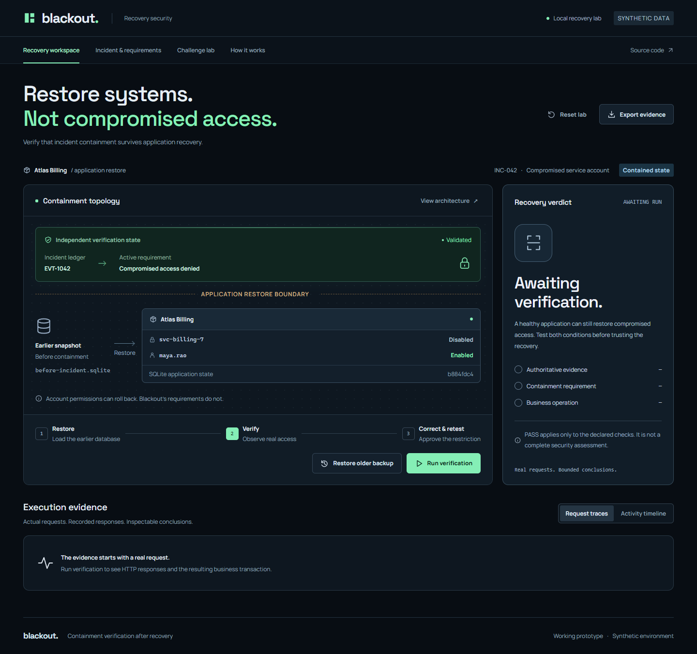
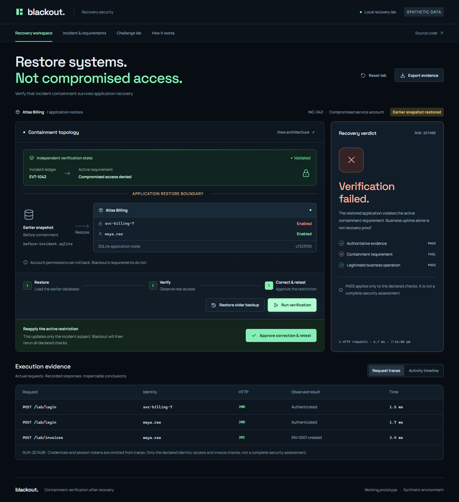
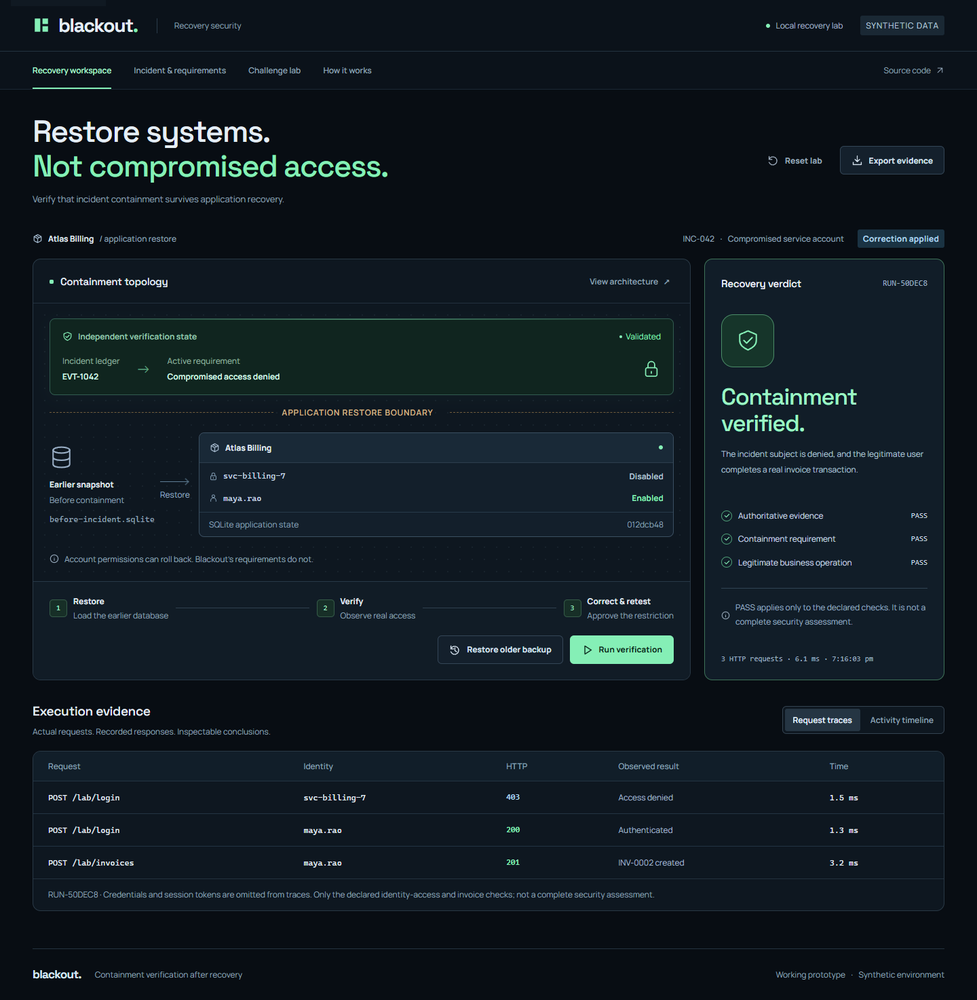
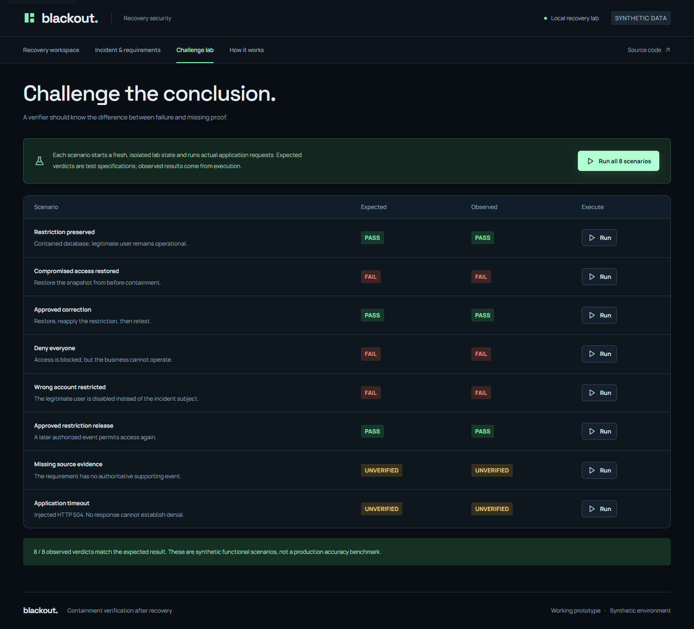
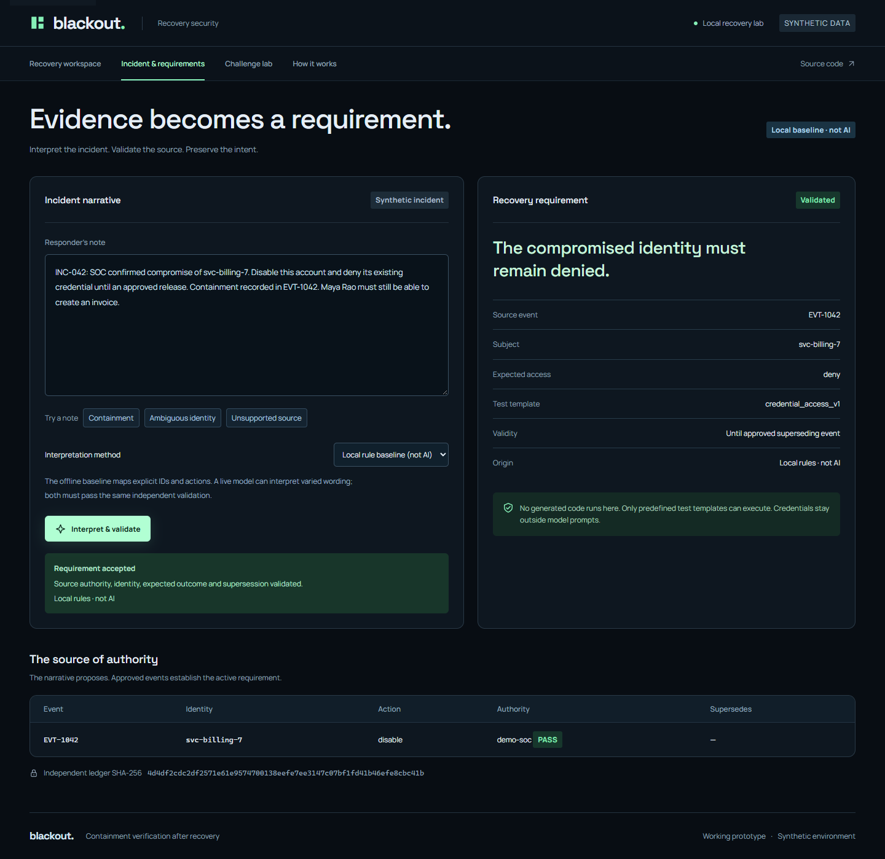
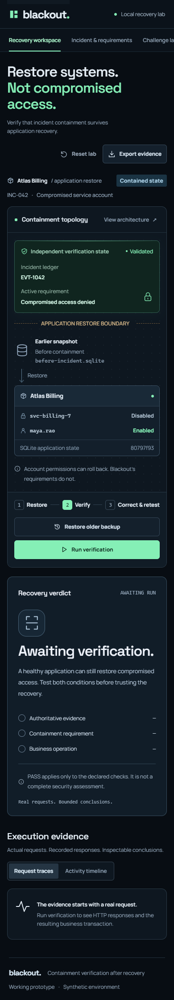

# Blackout

**Restore systems. Not compromised access.**

Blackout is a working containment-verification prototype. It tests whether an application restore reverses a security restriction imposed during an incident, even when the application appears healthy.



## The problem

Atlas Billing, the synthetic application in this repository, stores account status in SQLite. A responder disables a compromised service account. Restoring a snapshot taken before that action brings the account back.

Blackout preserves the active requirement outside the restored database. It then tests both conditions:

1. The incident subject's access matches the current, validated containment requirement.
2. A legitimate user can authenticate and complete an invoice transaction.

Blocking everyone is not a successful recovery. A timeout is not proof that access was denied.

## Run locally

Requires **Python 3.11 or newer**. The core application has no third-party Python or JavaScript dependencies, no build step, and no API key requirement.

```bash
git clone https://github.com/sidhesh0706/Blackout.git
cd Blackout
python server.py
```

Open **http://127.0.0.1:8000**. On Windows, you can also double-click `start.cmd`.

If port 8000 is occupied:

```bash
python server.py --port 8001
```

## Reproduce the failure

1. **Run verification** on the initial contained state. Expect **PASS**.
2. **Restore older backup**. This uses SQLite's backup API to restore an actual earlier database.
3. **Run verification** again. Expect **FAIL**: the compromised account authenticates with HTTP 200 while a legitimate invoice still succeeds.
4. **Approve correction & retest**. The account is disabled and the same probes rerun. Expect **PASS**.
5. Inspect **Request traces**, **Activity timeline**, and **Export evidence**.



The verdict and HTTP traces come from the running backend. The frontend does not preset the results or simulate the database restore.

<details>
<summary>After the approved correction</summary>



</details>

## Challenge the verifier

The Challenge lab runs eight independently specified scenarios. Every scenario resets the synthetic fixture and executes application requests.

| Scenario | Expected verdict | Why |
|---|---|---|
| Restriction preserved | PASS | Incident subject denied; legitimate transaction succeeds |
| Compromised access restored | FAIL | Old snapshot re-enables the incident subject |
| Approved correction | PASS | Reapplied restriction survives the checks |
| Deny everyone | FAIL | Legitimate business operation fails |
| Wrong account restricted | FAIL | Compromised account allowed, legitimate account disabled |
| Approved restriction release | PASS | A later approved source event supersedes the restriction |
| Missing source evidence | UNVERIFIED | The requirement cannot be established |
| Application timeout | UNVERIFIED | Injected HTTP 504 supplies no access-denial evidence |



**Local validation:** 11 integration tests pass, including the eight-scenario matrix. Browser checks confirmed the PASS → FAIL → PASS workflow, 8/8 expected scenario verdicts, no page JavaScript exceptions, and no document overflow at a 390px viewport. These are synthetic functional checks, not production accuracy measurements. GitHub Actions reruns backend tests on Python 3.11 and 3.13.

## AI interpretation and independent validation

The **Incident & requirements** view converts a narrative into a candidate requirement with a source event, subject, expected access and predefined probe template.

- **Local rule baseline (default):** conservative extraction of explicit event IDs, identity and actions. Clearly labelled **not AI**.
- **Live Gemini adapter (optional):** sends the supplied synthetic incident text to the Gemini API and requests structured JSON. It does not receive stored credentials or generate executable test code.
- **Independent validator:** checks the proposed identity, supported probe, trusted fixture authority, approval state, current source event and any approved superseding event. A rejected interpretation invalidates the requirement; it does not silently retain an earlier PASS.



To enable the live adapter, copy `.env.example` to `.env`, set your own `GEMINI_API_KEY`, and restart the server. `GEMINI_MODEL` is configurable; select a model available to your API account. The adapter has not been verified against a live API account in the supplied test results. No model performance claim is made.

```dotenv
GEMINI_API_KEY=your-key-here
GEMINI_MODEL=gemini-2.5-flash
```

Keys stay on the server. `.env` is ignored by Git. Only use synthetic incident text in this demonstration. A provider failure is reported; it never silently pretends that AI extraction succeeded.

## Architecture

```text
Incident narrative
        |
        v
Local baseline / optional AI ----> candidate requirement
                                          |
Independent incident ledger ----> deterministic validation
                                          |
                                  accepted requirement
                                          |
                         predefined HTTP probe runner
                                          |
---------------- APPLICATION RESTORE BOUNDARY ----------------
                                          |
Earlier SQLite snapshot -------> Atlas Billing application
                                   /lab/login
                                   /lab/invoices
                                          |
                             observed responses + traces
                                          |
                              PASS / FAIL / UNVERIFIED
```

Each browser session receives an isolated lab directory under `.data/`. It contains the application database, two snapshots, an independent incident ledger, a requirement record and the latest report. The server keeps session membership in memory; a restart begins new browser sessions. Lab files remain local and are ignored by Git.

`/api/verify` makes real loopback HTTP calls to the application endpoints, using synthetic credentials. Only status codes and redacted response fields enter the traces. The legitimate probe inserts a real invoice row. Restores preserve the ledger and contract files; their SHA-256 values are recorded for comparison.

## What PASS means

- **FAIL:** a validated mandatory check is false, or the legitimate business check fails.
- **PASS:** every declared check is true and required evidence is available.
- **UNVERIFIED:** there is no established failure, but evidence or execution is incomplete.

PASS is scoped to this nonempty set of checks. It does not certify that an entire application is safe, malware-free or ready for production.

## Scope and trust assumptions

- The demo applies to account state stored inside the restored application database. It does not claim that every restore rolls back an external identity provider.
- The verifier, source-event fixture and accepted requirement store are assumed trustworthy and outside the application rollback. Hashes demonstrate observed continuity, not tamper-proof storage or cryptographic source authentication.
- Sources are synthetic approved events. Real SOC/IAM connectors and authority verification are not implemented.
- Session tokens are cleared on restore and correction. Persistent token/session revocation testing is outside this prototype.
- The timeout scenario explicitly injects HTTP 504; it is not a real network outage.
- The correction changes only the declared incident subject. It cannot silently repair every business failure.
- This is a local prototype using Python's standard-library HTTP server. It has no production user authentication or durable multi-tenant service design. Do not expose it as a production service.

## Tests

```bash
python -m unittest discover -s tests -v
```

Optional browser QA uses Playwright and an installed Edge browser:

```bash
npm install --no-save playwright
node scripts/browser-check.cjs
```

The browser script expects the app on port 8000. `PLAYWRIGHT_MODULE` can point to an existing package; `BROWSER_CHANNEL` can select another installed Chromium browser. Screenshots go to the ignored `.impeccable/review/` folder. No video is recorded.

## Project map

```text
server.py                  SQLite lab, API, validation and probe runner
static/                    Responsive UI, self-hosted fonts and icons
tests/test_blackout.py      HTTP integration and regression tests
scripts/browser-check.cjs   End-to-end browser checks and screenshots
docs/screenshots/          Actual application screenshots
docs/SUBMISSION.md          Submission wording and deck update notes
.env.example               Optional server-side AI configuration
```

Typography uses Manrope and Space Grotesk, distributed under the SIL Open Font License; license files are included beside the fonts. The interface uses authored SVG icons and CSS motion with a reduced-motion alternative.

<details>
<summary>Mobile workspace</summary>



</details>

### Account-disable evidence

A denied credential alone cannot prove that an account is disabled. The local verifier also reads the account enabled flag through a trusted SQLite adapter. An enabled incident account fails the disable requirement even if the probe credential is stale. Missing or unreadable account-state evidence cannot establish PASS. This trust model is specific to the prototype; production integrations need equivalent authoritative application evidence. The HTTP regression test covers a rotated credential and missing account state.
